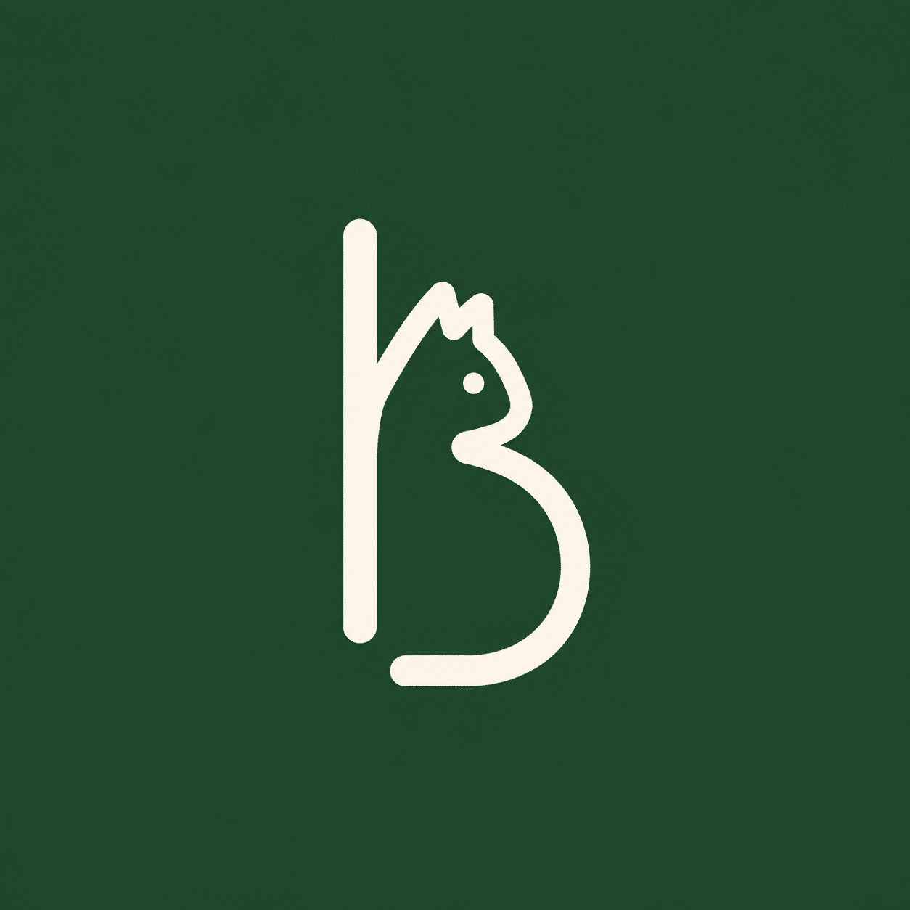

  

<h1 align="center">EazyBB</h1>

非官方南科大Blackboard集成Chrome拓展程序

**EazyBB** 是一个集成南科大Blackboard大多数功能的 Chrome 扩展，配置好登录账号后，点击图标即可在侧边栏快速访问bb上的文件、公告等内容，最少仅需点击**两次**就能打开课程所需PPT，能有效避免卡点上课时对着CAS的加载图标大眼瞪小眼的困扰。

## 已实现的功能

- [x] **导航**：根据设置的课表同步显示当前的课程，或者剩下的作业，或者...去玩吧
- [x] **日历与作业**：显示当前作业和ddl
- [x] **课程详情**：显示bb中该课程获取到的内容树，并支持(以复杂的半成品逻辑)自定义把内容树拆分显示
- [x] **课程表**：从TIS中获取课程表或者自己上传ics文件，并支持根据校历自动设置调休
- [x] **考试**：从本地添加考试。后续将实现从TIS获取考试信息。
- [x] **附件预览**：一键直达课件！在浏览器主界面打开新窗口预览附件(和bb的逻辑一样)
- [x] **个性化设置**：自定义显示内容~

## 等待实现

- [ ] **作业提交**：仍在测试，这个功能要保证**完全可靠**才能上线！
- [ ] **外观与布局**：如你所见，这是一个vibe coding项目。我们需要有品位的设计师
- [ ] **内容树逻辑**：目前内容树的拆分逻辑设计程度已达到作者脑容量上限，欢迎聪明的同学来优化
- [ ] **自定义课程详情页**：目前只能拆解内容树，还有很多功能没有实现
- [ ] **校历调休**：目前只内置了 2026 年本科校历数据，暂未找到可靠的能稳定访问的订阅源同步校历（其实也就每年一次）
- [ ] **新的主页卡片**：产品经理在哪里
- [ ] **AI接入**：什么叫大肥鱼催我写作业？！

## 安装与使用

在release中下载`EazyBB.zip`，解压后打开你的浏览器"拓展程序"设置，点击"加载未打包的拓展程序"按钮，然后选择解压的文件夹。

首次使用需要在主页右上角的"设置"页面中填上你的学号和密码（记得关闭CAS的手机验证码登录保护），然后去主页手动同步一次课程表。

所有数据只在你的电脑本地存储，不会上传到任何地方~

## 鸣谢

本项目基于 [sustech_survival](https://github.com/dumixthestpd/sustech_survival) 构建，为vibecoding社同学们的探索精神点赞！

项目依然有很多地方需要打磨，欢迎来提pr，一起为EasyBB贡献！

任何意见反馈：12413313@mail.sustech.edu.cn
